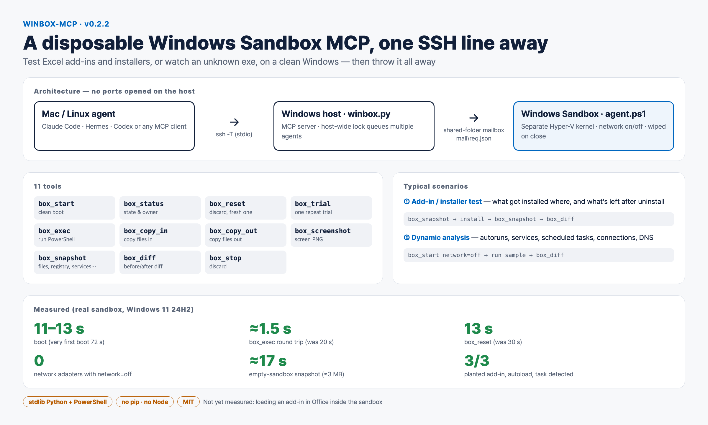

# winbox-mcp

[한국어](README.md) | English



**A disposable Windows Sandbox MCP server, one SSH line away.**
Test Excel add-ins and installers, or run reverse-engineering experiments (an unknown exe), on a clean Windows — then throw the whole thing away.

- Python standard library + PowerShell only. No `pip install`, no Node, no npm.
- No ports are opened on the host. MCP runs over SSH stdio; host ↔ sandbox talk through a single shared-folder mailbox.
- So the same tools work unchanged **even in a sandbox with networking turned off**.

```
 Mac/Linux agent ──ssh(-T)──▶ Windows host: winbox.py (MCP)
                                 │ shared-folder mailbox (mail\req.json → mail\res)
                                 ▼
                            Windows Sandbox: guest\agent.ps1
                            (network on/off, everything wiped on close)
```

## Requirements (Windows host)

1. Windows 10/11 **Pro, Enterprise or Education** (Home has no Sandbox), virtualization enabled
2. `Turn Windows features on or off` → check **Windows Sandbox** → reboot
3. OpenSSH Server (anything that lets you reach it remotely, e.g. Tailscale, is fine)
4. Python 3.9+ (`py -3`)
5. From Mac/Linux: `./install.sh <user>@<host>` — copies to `winbox-mcp` in the host's home and runs a self-check
6. Someone must be **logged in at the host console** — the Sandbox window opens in the logged-in desktop session. When called over SSH, winbox launches it into that session via a scheduled task (`schtasks /IT`).

## Hooking it up to an agent

You need SSH key login (if a password prompt appears, the MCP hangs). Every option below boils down to the same line:
`ssh -T -o BatchMode=yes <user>@<host> "py -3 winbox-mcp\winbox.py"`

**Claude Code — plugin** (installs the MCP server and the usage skill together)

```
claude plugin marketplace add kims6305-bjk/winbox-mcp
claude plugin install winbox@winbox --config host=<user>@<host>
```

**Hermes** — add to `config.yaml`, and copy `skills/winbox` into `~/.hermes/skills/` for the usage skill

```yaml
mcp_servers:
  winbox:
    command: ssh
    args: ["-T", "-o", "BatchMode=yes", "<user>@<host>", "py -3 winbox-mcp\\winbox.py"]
    timeout: 900
```

**Codex CLI**

```
codex mcp add winbox -- ssh -T -o BatchMode=yes <user>@<host> "py -3 winbox-mcp\winbox.py"
```

Any other MCP client works with `command: ssh` and the arguments above.

## 11 tools

| Tool | What it does |
|---|---|
| `box_start` | Boot a clean sandbox. With `network: off` there is no network adapter at all |
| `box_status` | Is it running; if not, is another agent using it |
| `box_reset` | Discard the current sandbox for a fresh one (keeps your slot) |
| `box_trial` | One repeat trial: fresh sandbox → snapshot → copy in → run → snapshot → diff |
| `box_exec` | Run PowerShell inside the sandbox → exit code, stdout, stderr (with timeout) |
| `box_copy_in` | Host file/folder → sandbox `C:\winbox\in` (read-only on the sandbox side) |
| `box_copy_out` | Sandbox file → host |
| `box_screenshot` | Screen as PNG |
| `box_snapshot` | Files, registry, COM registrations, services, scheduled tasks, processes, TCP connections, DNS cache |
| `box_diff` | Compare two snapshots — added / removed / changed |
| `box_stop` | Discard the sandbox. The run folder (`%LOCALAPPDATA%\winbox\runs\…`) is kept |

## Usage — typical scenarios

### 1) Testing an Excel add-in or installer (does it work on a clean PC?)

```
box_start → box_snapshot before → box_copy_in setup.exe → box_exec "& C:\winbox\in\setup.exe /quiet"
→ box_snapshot installed → box_diff before installed      # what went where (AddIns, XLSTART, HKCU\Software\Microsoft\Office, CLSID)
→ (run uninstall) → box_snapshot removed → box_diff before removed   # leftovers after removal
→ box_stop
```

The sandbox has **no Office**. To see whether the add-in actually loads inside Excel you must install Office each time
(download the install source once on the host with the Office Deployment Tool, then `box_copy_in` → offline install). This path has not been measured yet.

### 2) Reverse-engineering experiment (what does an unknown exe actually do?)

```
box_start network=off → box_snapshot before → box_copy_in sample.exe
→ box_exec "Start-Process C:\winbox\in\sample.exe; Start-Sleep 60"
→ box_snapshot after → box_diff before after   # autoruns, services, scheduled tasks, new files, connection attempts, DNS lookups
→ box_screenshot → box_stop
```

Analysis tools such as Procmon or x64dbg are not in the sandbox. Bring portable builds in with `box_copy_in` if you need them.

### 3) Fix and reinstall (iterate)

Each time you fix the build, one `box_trial` is enough. Every run starts from a clean sandbox, and `{in}` is replaced with the path of the copied-in file.

```
box_trial host_path=C:\build\MyAddin command="& {in} /quiet"     # run 1: fails → fix
box_trial host_path=C:\build\MyAddin command="& {in} /quiet"     # run 2: again, in a fresh sandbox
box_trial ... clean=false snapshot=false                          # quick runs: same sandbox, no snapshots
```

Copying in a file or folder with the same name overwrites it.

### When several agents share it

There is **only one** Windows Sandbox per host. So winbox shares the slot with a host-wide lock (`%LOCALAPPDATA%\winbox\lock.json`).

- If someone is using it, `box_start` refuses with "in use by another agent: <owner> (pid, start time)".
- Pass `box_start wait_s=600` to queue until the slot frees up.
- Label yourself with `owner` (or the `WINBOX_OWNER` environment variable). `box_status` shows who is using it now.
- If the winbox holding the lock dies, the lock is treated as ownerless and the next caller takes over, cleaning up the leftover sandbox.

### Testing the wiring without a sandbox

With `WINBOX_LOCAL=1` the agent runs **on the host** instead of in a sandbox. This is for checking the SSH/MCP/mailbox wiring; there is no isolation,
so only run commands you trust. In this mode the agent never shuts the computer down (the shutdown command only runs under the sandbox-only account `WDAGUtilityAccount`).

## Security notes

- The sandbox is a separate kernel isolated by Hyper-V, and everything inside is wiped when it closes.
- Clipboard, microphone, camera and printer redirection are off.
- Only 3 folders are shared with the host: `tools` (read-only), `in` (read-only), `mail` (read/write).
- The `mail` folder is writable from inside the sandbox, so treat anything you copy out as **untrusted data**. winbox only reads JSON and PNG from it and never executes anything there.
- The agent shuts the sandbox down on its own after 30 minutes without requests. On a clean MCP disconnect it cleans up immediately; a forced disconnect is left to that 30-minute idle shutdown.
- It does not protect against sandbox-escape vulnerabilities. For real malware analysis, use a dedicated analysis machine.

## Measurements (v0.2.2)

Verified against a **real Windows Sandbox**, Mac → Tailscale SSH → Windows 11 host (24H2, 26100 sandbox):

- Boot: 72 s for the very first boot after enabling the feature, 11–13 s after that.
- `box_exec` round trip about 1.5 s (mostly PowerShell startup). Korean output, exit codes, stderr and timeouts all correct; account is `WDAGUtilityAccount`.
- `network=off`: 0 network adapters, outbound connections confirmed to fail.
- Empty-sandbox snapshot: about 3 MB and about 17 s each (4,494 files, 6,121 registry values) — far smaller than a real working PC (219 MB, 4 minutes).
- Before/after install diff: caught all three planted items — an add-in (`AddIns\winbox-test.xlam`), an Excel autoload (`Excel\Options\OPEN`) and a scheduled task (`\wbtest`).
- Screenshot: the sandbox desktop is captured correctly (2032×1111).
- Two agents at once (local mode): while A was using it, B was refused immediately; a B queued with `wait_s` got the slot right after A released it.

### Found and fixed by measuring

- **Sandbox shared folders show new file names late.** A file newly created by the host only appears inside the sandbox on a roughly 20-second cycle, but content changes to an existing file showed up within 0.4 s. So requests are sent by overwriting a single `req.json` instead of creating new files (round trip 20 s → 1.5 s). `box_copy_in` returns only after the file is actually visible inside the sandbox.
- On Korean-language Windows, `tasklist` output was decoded incorrectly and the lock check crashed.
- Boot failed with a **"too many sessions are configured on the network server"** dialog. Killing the Sandbox window left the VM running, and starting a new sandbox in that state shows this dialog. Now, on shutdown, the VM is killed directly with `hcsdiag kill` and winbox waits until it is fully down. Even if the previous agent was force-killed, the next agent takes over in 13 s, and `box_reset` went from 30 s to 13 s. (`hcsdiag` needs administrator rights, so if the SSH account is not an administrator you have to clean up a leftover VM yourself.)

**Not yet measured**: installing Office inside the sandbox to see the add-in actually load in Excel; Codex registration.

## Why it is smaller than similar tools

Similar public tools target Windows app developers, so they ship MSIX packaging, automatic runtime installs, screen recording, UI automation and several wrappers for other agents.
winbox looks at only two uses: **add-in/installer testing** and **dynamic analysis**. In exchange it includes what those two need — before/after diffs, repeat trials, and queueing for multiple agents.

## Deliberately left out

UI automation (finding and clicking buttons), screen recording, MSIX apps, automatic runtime installs. UI automation comes first once clicking through Excel itself becomes necessary.

## Tests

```
python3 test_winbox.py                                       # anywhere (config generation, diff, lock, MCP responses)
WINBOX_HOST=<user>@<host> python3 mcp_probe.py local < steps.json   # real round trip over SSH (WINBOX_LOCAL)
```

## License

MIT
